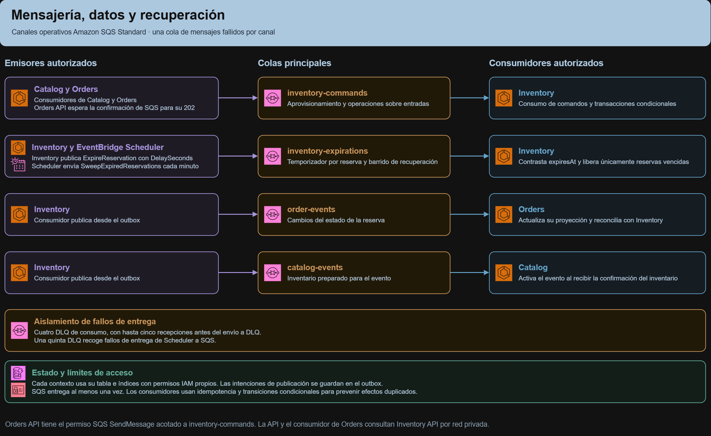

# Plataforma de venta de entradas

API reactiva para publicar eventos, reservar entradas numeradas, confirmar compras y consultar disponibilidad. Catalog administra los eventos, Orders recibe las órdenes e Inventory asigna las entradas. Los tres servicios usan Java 25, Spring Boot 4.1.2 y WebFlux sobre el Scaffold Clean Architecture de Bancolombia. DynamoDB mantiene los datos y SQS procesa los comandos y eventos.

## Instalación y arranque local

1. Instala Docker con Compose v2 y soporte para contenedores Linux. La primera compilación requiere acceso a Internet para descargar imágenes y dependencias.
2. Desde la raíz de `ticketing-platform`, verifica la configuración y levanta el entorno. Docker incluye Java y Gradle en la compilación. Las pruebas Gradle fuera de Docker requieren JDK 25. Los scripts de verificación local requieren Python 3 y los ejemplos de la API usan `curl` en Bash.

```bash
docker compose version
docker compose config --quiet
docker compose up --build --wait
docker compose ps
```

3. Cuando las APIs y los consumidores estén listos, comprueba los puntos de salud y sigue los ejemplos de la sección siguiente.

```bash
curl --fail http://localhost:18080/actuator/health/readiness
curl --fail http://localhost:18081/actuator/health/readiness
curl --fail http://localhost:18082/actuator/health/readiness
```

| Componente | Dirección local |
|---|---|
| Catalog | `http://localhost:18080` |
| Orders | `http://localhost:18081` |
| Inventory | `http://localhost:18082` |
| DynamoDB Local | `http://localhost:18000` |
| LocalStack SQS | `http://localhost:4566` |

Compose inicia una API y un consumidor por contexto con la misma imagen. Los consumidores solo son accesibles dentro de la red de Docker. El arranque crea las tablas de DynamoDB Local y cuatro colas SQS con sus respectivas colas de mensajes fallidos (DLQ). La simulación local funciona con identidades y credenciales de prueba sin cuenta AWS.

`docker-compose.yml` define los puertos, `APP_ROLE`, `API_ENABLED`, `WORKERS_ENABLED`, `AUTH_MODE` y las direcciones de DynamoDB y SQS. Las reglas de cada contexto están en su `application.yaml`. Para cambiar estos valores en AWS se utiliza [ticketing-infra](../ticketing-infra/README.md).

Para seguir los registros y detener el entorno, usa los comandos siguientes. Al detenerlo, DynamoDB conserva sus tablas en un volumen. LocalStack Community recrea las colas vacías al reiniciar; el entorno local es para demostración y pruebas.

```bash
docker compose logs -f --tail 100 catalog orders inventory inventory-worker localstack
docker compose stop
```

Si levantaste el entorno con `docker compose -p <proyecto>`, repite `-p <proyecto>` en los comandos de operación. Si hay puertos ocupados, consulta `docker compose ls` para identificar si corresponde a una instancia previa de esta plataforma.

## Ejemplos de uso de la API

Ejecuta los comandos en orden. Sustituye `EVENT_ID` por el `eventId` de la respuesta, `ORDER_ID` por el `orderId` de la compra y `COURTESY_ID` por el `orderId` de la cortesía. Usa nuevas claves de idempotencia si haces otro recorrido. Los tokens de ejemplo son locales.

**Crear y consultar un evento.** La solicitud devuelve `202` y el `eventId`.

```bash
curl -i http://localhost:18080/api/v1/events \
  --oauth2-bearer local-admin \
  -H 'Idempotency-Key: demo-evento-001' \
  -H 'Content-Type: application/json' \
  -d '{"name":"Concierto de prueba","venue":"Teatro local","startsAt":"2030-01-15T19:00:00Z","capacity":20}'
```

Repite la consulta por ID hasta que `status` sea `ACTIVE`. También puedes consultar la primera página del listado.

```bash
curl http://localhost:18080/api/v1/events/EVENT_ID \
  --oauth2-bearer local-customer-1

curl 'http://localhost:18080/api/v1/events?limit=5' \
  --oauth2-bearer local-customer-1
```

**Solicitar y confirmar una compra.** Orders responde `202` con el `orderId` cuando SQS confirma la recepción del comando.

```bash
curl -i http://localhost:18081/api/v1/orders \
  --oauth2-bearer local-customer-1 \
  -H 'Idempotency-Key: demo-compra-001' \
  -H 'Content-Type: application/json' \
  -d '{"eventId":"EVENT_ID","ticketIds":["1","2"]}'
```

Repite este GET hasta que `workflowStatus` sea `AWAITING_CONFIRMATION`.

```bash
curl http://localhost:18081/api/v1/orders/ORDER_ID \
  --oauth2-bearer local-customer-1
```

Confirma antes de `expiresAt`. Después, repite el GET hasta que `status` sea `SOLD`.

```bash
curl -i -X POST http://localhost:18081/api/v1/orders/ORDER_ID/confirm \
  --oauth2-bearer local-customer-1 \
  -H 'Idempotency-Key: demo-confirmacion-001'

curl http://localhost:18081/api/v1/orders/ORDER_ID \
  --oauth2-bearer local-customer-1
```

**Emitir una cortesía y consultar disponibilidad.** Asigna la entrada `3` como administrador.

```bash
curl -i http://localhost:18081/api/v1/admin/complimentary-orders \
  --oauth2-bearer local-admin \
  -H 'Idempotency-Key: demo-cortesia-001' \
  -H 'Content-Type: application/json' \
  -d '{"eventId":"EVENT_ID","ticketIds":["3"],"beneficiaryId":"local-customer-1","reason":"Invitación al evento"}'
```

Repite la primera consulta hasta que `status` sea `COMPLIMENTARY`. En disponibilidad verás `available=17`, `sold=2` y `complimentary=1`.

```bash
curl http://localhost:18081/api/v1/orders/COURTESY_ID \
  --oauth2-bearer local-customer-1

curl http://localhost:18082/api/v1/events/EVENT_ID/availability \
  --oauth2-bearer local-customer-1
```

## Colección de Postman

1. Importa [ticketing.postman_collection.json](contracts/ticketing.postman_collection.json) y selecciona **No Environment**. La colección ya define las URLs e identidades locales. Un entorno con variables como `eventId` u `orderId` puede reemplazar las de la colección.
2. Abre **Ticketing — aceptación local**, selecciona **Run collection** e inicia desde **01 Crear evento** con una demora de 500 ms entre solicitudes. El recorrido genera un evento nuevo y guarda los identificadores de cada respuesta.
3. En el paso **08 Rechazar consulta de otro comprador** se espera `404 ORDER_NOT_FOUND`. En **12 Rechazar cambios con la misma clave** se espera `409 IDEMPOTENCY_CONFLICT`. Estas respuestas prueban el aislamiento por propietario y el uso de la clave de idempotencia.

La colección pasa por creación, reserva, reintento, confirmación, cortesía y consulta de disponibilidad. La espera real de diez minutos, la caída de LocalStack y la contención se verifican por separado. [Guía de la colección](scripts/postman/README.md) · [Resultados de la prueba](docs/evidencia.md)

## Decisiones de diseño

| Decisión | Motivo y costo |
|---|---|
| Arquitectura limpia con puertos y adaptadores | Los casos de uso concentran las reglas de negocio y se prueban sin AWS. Cada contexto posee su tabla y su despliegue, lo cual exige contratos de integración y operación por servicio. |
| Una autoridad de inventario | Inventory aplica escrituras condicionales sobre entradas, reservas, contadores y auditoría en transacciones DynamoDB. Las consultas de órdenes dependen de Inventory para confirmar el estado actual. |
| Outbox transaccional y SQS Standard | La orden y el comando se guardan juntos. Orders responde `202` tras confirmar el encolado de compras y cortesías. Los consumidores deduplican entregas y verifican versiones. Si Orders devuelve `503 ORDER_ENQUEUE_UNAVAILABLE`, se reintenta con el mismo cuerpo y la misma clave. |
| Vencimiento de 600 segundos | El plazo se fija al guardar la orden. Una reserva genera un mensaje diferido y se recupera mediante un barrido cada minuto. El consumidor valida el plazo y el estado aun si el mensaje se retrasa o llega más de una vez. |
| Escalado por rol y mínimo privilegio | En AWS las APIs y los consumidores escalan por separado. Orders API puede enviar únicamente a `inventory-commands`. Los consumidores reciben y publican en las colas de su contexto según su función. |

`RESERVED` y `PENDING_CONFIRMATION` ocupan capacidad. `SOLD` es una venta final y `COMPLIMENTARY` es una asignación final que se cuenta por separado. La consulta de disponibilidad devuelve los contadores del inventario. La reserva definitiva se decide con las condiciones de escritura de Inventory.

## Interacciones entre componentes



1. **Alta del evento.** Catalog publica el comando para preparar sus entradas. Inventory numera las entradas y avisa a Catalog por SQS para cambiar el evento a `ACTIVE`.
2. **Compra y confirmación.** Orders guarda la orden y su comando en una transacción. Devuelve `202` cuando SQS confirma la recepción. Inventory reserva las entradas con escrituras condicionales y comprueba el plazo al confirmar la compra.
3. **Vencimiento y consulta.** Inventory libera la reserva al procesar el mensaje diferido. Un barrido cada minuto recupera vencimientos pendientes. Orders recibe los cambios por SQS y consulta a Inventory por HTTP para leer el estado actual de una reserva.

- [Diagrama de flujo entre servicios](docs/arquitectura.md#servicios-y-comunicación)
- [Diagrama de secuencia del alta de un evento](docs/arquitectura.md#alta-de-un-evento)
- [Diagrama de secuencia de compra y vencimiento](docs/arquitectura.md#compra-y-vencimiento)

## Sustentación y operación

- [Arquitectura, mensajería y diagramas de secuencia](docs/arquitectura.md)
- [Operación y pruebas locales](docs/operacion.md)
- [Resultados por requisito](docs/evidencia.md)
- Contratos [HTTP](contracts/openapi.json) y [SQS](contracts/asyncapi.json)
- Infraestructura, seguridad, costos y operación en AWS en el `README.md` del repositorio independiente `ticketing-infra`

El entorno local comprobó concurrencia, recuperación y vencimiento. El despliegue AWS, la carga sostenida y el costo real requieren medición en AWS. Para producción se debe verificar el aislamiento de red y permisos, evaluar TLS en los saltos privados y ajustar el escalado con métricas de demanda.
