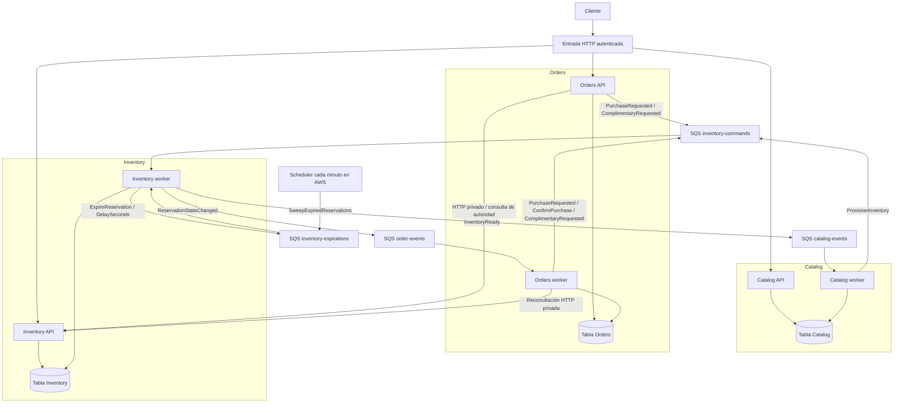

# Arquitectura de ejecución

Tres contextos de negocio —Catalog, Orders e Inventory— generan tres imágenes. Cada imagen ejecuta dos roles independientes, API y worker, mediante `APP_ROLE`, `API_ENABLED` y `WORKERS_ENABLED`. Son seis despliegues y tres límites de propiedad de datos. El repositorio `ticketing-infra` contiene Terraform, redes, identidades, colas, alarmas y promoción de infraestructura por separado.

## Contextos y responsabilidades

| Contexto | API | Worker | Datos propios |
|---|---|---|---|
| Catalog | Crear y consultar eventos; alta exige administrador. | Publicar ProvisionInventory desde outbox y consumir InventoryReady para activar el evento. | Evento, idempotencia, inbox/outbox. |
| Orders | Crear/consultar orden, solicitar confirmación y registrar cortesías administrativas. | Publicar comandos desde outbox, proyectar ReservationStateChanged y reconciliar con Inventory. | Orden, proyección versionada, idempotencia, inbox/outbox y revisión pendiente. |
| Inventory | Consultar entradas/disponibilidad y atender operaciones internas de Orders. | Procesar comandos, temporizadores y recuperación; publicar cambios de reserva y alta completada. | Entradas, reserva, contadores, auditoría, índices de expiración, outbox y leases. |

API y worker comparten únicamente la tabla de su contexto. Ningún servicio accede a una tabla ajena. Inventory es la autoridad sobre titularidad, estado y capacidad de las entradas; Orders conserva una proyección que puede ir retrasada. Consultar una orden contrasta su estado con Inventory antes de presentar un resultado definitivo.

El scaffold de Bancolombia conserva las capas `domain/model`, `domain/usecase`, `infrastructure/entry-points`, `infrastructure/driven-adapters` y `applications/app-service`. Los casos de uso dependen de puertos del dominio; WebFlux, SQS y DynamoDB son adaptadores. Los ejemplos del generador se conservan para identificar su origen; no son endpoints públicos adicionales.

## Flujo de ejecución

Cada cola principal tiene una DLQ de consumo. Scheduler tiene otra DLQ para errores al entregar su mensaje a SQS. Un fallo de entrega y un fallo del consumidor requieren diagnósticos y replays distintos.

Las APIs escriben negocio e intención en una transacción de su tabla. Para compras y cortesías, Orders API intenta publicar el comando persistido con el mismo mecanismo de reclamo que usa el relay. El worker recupera los envíos pendientes y publica los comandos de confirmación. Una caída entre publicación y marcado puede producir duplicados. Los IDs estables, versiones, transacciones condicionales e idempotencia evitan repetir efectos.

## Reserva y confirmación

1. Orders valida identidad, selección e Idempotency-Key, persiste orden e intención de compra con `requestedAt` y `expiresAt=requestedAt+600s`. Reintentar no crea otro plazo.
2. Orders responde `202 Accepted` después de confirmar que SQS aceptó `PurchaseRequested`, sea en el intento actual o en uno previo. Si falta confirmación, responde `503 ORDER_ENQUEUE_UNAVAILABLE`. El relay recupera los comandos pendientes y el consumidor de Inventory aplica el deadline original.
3. Inventory reclama entradas vencidas cuando corresponde y reserva mediante condiciones sobre estado/versión y una transacción. La reserva y su temporizador de expiración quedan persistidos con su outbox. Dos compradores concurrentes no pueden adquirir la misma entrada mediante una transición válida.
4. Una confirmación aceptada por Orders produce ConfirmPurchase. Inventory verifica propiedad, ID del comando y deadline; transita RESERVED → PENDING_CONFIRMATION → SOLD. Si vence antes de completar, libera la retención. Un `202` de solicitud no significa venta confirmada.
5. ReservationStateChanged actualiza Orders mediante versión de Inventory; un evento viejo no puede revertir una proyección más nueva. La reconciliación recupera eventos perdidos o retrasados consultando la autoridad.

Las cortesías exigen administrador y motivo, conservan actor/beneficiario y terminan en COMPLIMENTARY. SOLD y COMPLIMENTARY son estados finales: ni TTL, ni un replay ni el vencimiento de una reserva los vuelven disponibles.

La invariante de capacidad es:

`capacity = available + reserved + pendingConfirmation + sold + complimentary`

Los cambios que afectan varias entradas, reserva, contadores y outbox se coordinan dentro de DynamoDB mediante transacciones y condiciones; no existe una transacción distribuida entre las tres tablas.

## Tiempo y recuperación

`expiresAt` persistido es el reloj de negocio. El mecanismo principal es `ExpireReservation` en la cola separada `inventory-expirations`. Al publicar se calcula el tiempo restante con redondeo hacia arriba, `DelaySeconds` entre 0 y 600. El mensaje conserva el deadline original; el consumer rechaza un deadline distinto y no libera anticipadamente. Un mensaje duplicado que encuentra una transición ya concluida no repite sus efectos.

Scheduler genera cada minuto `SweepExpiredReservations` con schemaVersion 1. Su único destino es SQS; no invoca un endpoint público ni Lambda. El worker adquiere un lease global durable antes de consultar los 16 shards del índice de expiración, con cooldown de 60 segundos. El barrido pagina en lotes de 100 y tiene tiempo acotado; las réplicas y los duplicados no deben multiplicar las consultas de recuperación.

En local no se simula una cuenta EventBridge: el único contenedor `expiry-recovery` genera mensajes de recuperación a la misma cola cada minuto. Los workers de Compose no ejecutan un barrido periódico local. AWS usa el Scheduler definido en Terraform.

SQS y Scheduler no garantizan una ejecución en el segundo exacto. El deadline de aceptación sigue siendo 600 segundos; la materialización de la liberación puede retrasarse por cola, caída o recuperación. Consultas/operaciones de Inventory también verifican expiración y recuperan entradas vencidas. TTL de DynamoDB elimina residuos después de su retención; nunca decide disponibilidad.

El outbox usa un lease durable de 30 s con renovación y backoff adaptativo entre 500 ms y 10 s, más jitter de hasta 250 ms. Los followers esperan según el lease observado. Esto reduce consultas vacías y duplicación entre réplicas. Una intención pendiente de recuperar por el relay puede esperar ese backoff. La latencia p95 se mide por escenario.

## Escalado y seguridad

| Rol | HTTP de negocio | SQS | Escalado AWS |
|---|---|---|---|
| API | Activado; publicado solo por las rutas autorizadas. | Orders requiere permiso de envío a `inventory-commands` para compras y cortesías. | Target tracking CPU, objetivo 60 %. |
| Worker | Desactivado; conserva health/readiness. | Consume/publica solo colas del contrato. | Step scaling por backlog visible de sus colas. |

El worker de Inventory consume commands y expirations de forma independiente dentro del mismo proceso. Las alarmas de escalado suman ambas colas. Scale-out añade una tarea desde 32 mensajes visibles y dos desde 160; cooldown 60 s. Scale-in exige cinco minutos con la suma de visibles e in-flight inferior a uno, retira una tarea y espera 300 s. Son parámetros iniciales que requieren pruebas de carga. Los mínimos activos conservan ejecución de outbox y recuperación.

AWS mantiene las tareas privadas en dos zonas, sin NAT ni IP pública. HTTP API Gateway verifica JWT de Cognito y sobrescribe los headers de identidad antes de VPC Link → ALB interno → API. Solo hay nueve rutas públicas explícitas. Los security groups permiten Orders API/worker → Inventory API; no publican workers ni rutas internas al exterior. Los roles IAM separan ejecución de contenedor y permisos de negocio.

La autenticación local `Bearer local-customer-1`, `local-customer-2` o `local-admin` es exclusiva del perfil local. No representa seguridad Cognito ni se admite como credencial AWS. Los saltos privados HTTP de esta entrega son un límite explícito; no se afirma TLS de extremo a extremo o certificación regulatoria.

## Local y AWS

| Elemento | Local | AWS preparado en ticketing-infra |
|---|---|---|
| Proceso | Docker Compose, tres imágenes y seis roles. | ECS Fargate, API/worker escalables por separado. |
| Datos | DynamoDB Local, tabla por contexto. | DynamoDB on-demand, KMS; PITR en QA/PROD. |
| Mensajería | ElasticMQ; pruebas del flujo que implementa el emulador. | SQS Standard con cifrado, redrive, DLQ y alarmas. |
| Recuperación de vencimientos | Un contenedor expiry-recovery publica SweepExpiredReservations. | EventBridge Scheduler → SQS con retry acotado y DLQ propia. |
| Identidad | Identidades locales de prueba. | Cognito + autorización JWT, claims y ownership. |
| Operación | Logs/health y evidencia de los scripts locales. | CloudWatch, métricas SQS/API Gateway, filtros de logs y alarmas. |

Pasar una prueba con ElasticMQ no demuestra permisos IAM, consistencia del servicio real, comportamiento de KMS, latencia AWS o cumplimiento de cuotas. Las pruebas Terraform simulan el provider y ejecutan planes; no constituyen un despliegue.

Los workers emiten logs estructurados con campos `metric` y `value`: `outbox_age_seconds` por contexto y `expiration_lag_seconds` en Inventory. Terraform configura filtros en los log groups de workers. La verificación de stdout local y la recepción/alarma efectiva en CloudWatch son evidencias distintas; el despliegue cloud y esa última comprobación permanecen pendientes de autorización.

## Evidencia y decisiones

Los resultados locales, SHA y limitaciones se conservan en `docs/evidence` y en los artifacts de calidad por commit. Los runbooks de red, IAM, escalado, DLQ, costos, rollback y recuperación pertenecen a `ticketing-infra/docs`. No se ejecuta Terraform apply desde los pipelines de esta entrega. La arquitectura describe esta solución y no atribuye decisiones internas a Nequi.
