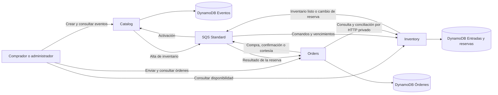
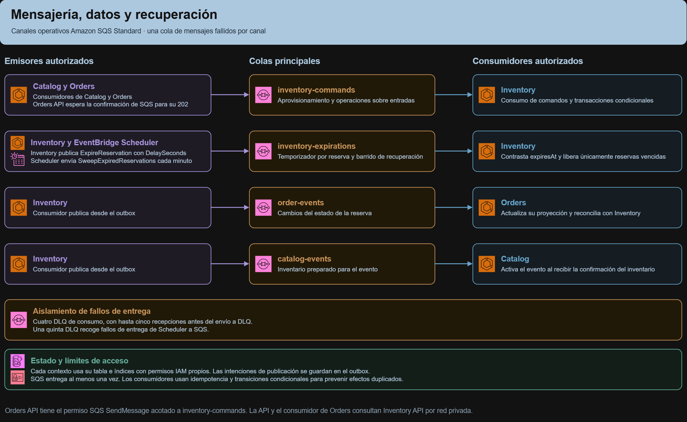
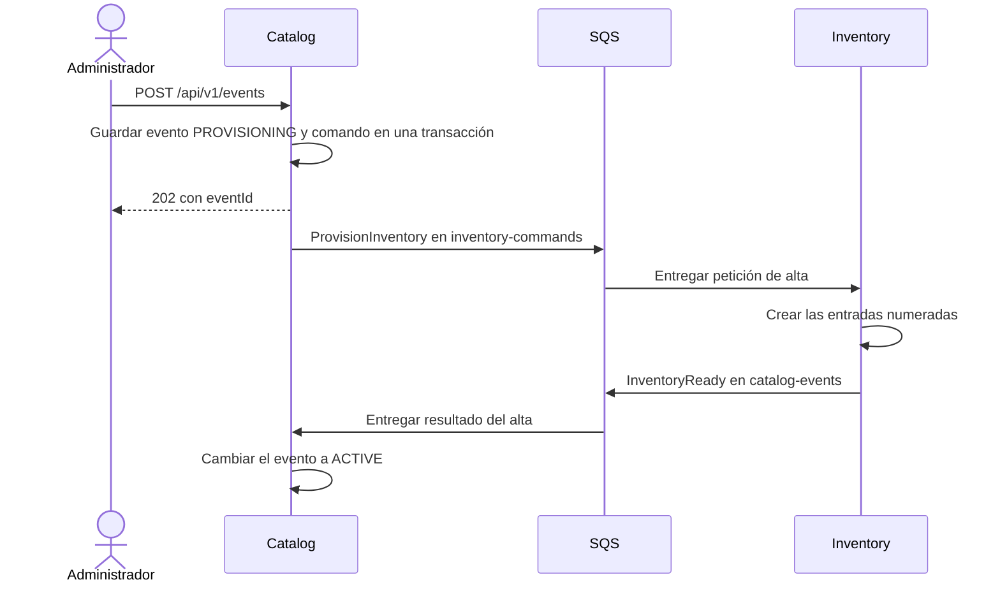
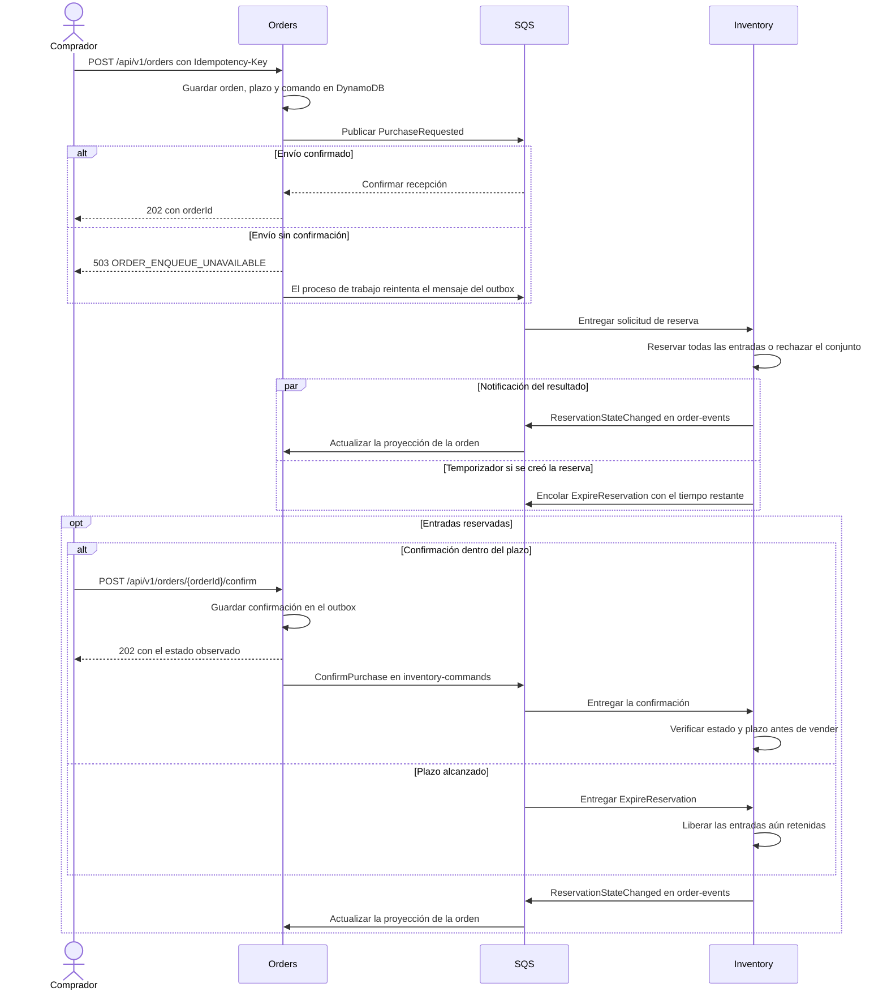

# Arquitectura

Catalog administra los eventos. Orders recibe compras, confirmaciones y cortesías. Inventory asigna las entradas y calcula la disponibilidad. Cada servicio tiene su propia tabla DynamoDB, una API WebFlux y un proceso de trabajo que puede escalar aparte. Los casos de uso del Scaffold Clean Architecture se conectan a HTTP, DynamoDB y SQS mediante adaptadores.

## Servicios y comunicación

### Mensajería y datos en AWS

| Cola | Quién publica y quién la lee |
| --- | --- |
| `inventory-commands` | Catalog solicita crear las entradas. Orders pide reservar, confirmar o emitir una cortesía. Inventory ejecuta los cambios. |
| `inventory-expirations` | Inventory publica el temporizador de cada reserva. EventBridge Scheduler envía el aviso de recuperación en AWS. Inventory procesa ambos. |
| `catalog-events` | Inventory avisa que las entradas ya existen. Catalog activa el evento. |
| `order-events` | Inventory publica el estado y la versión de la reserva. Orders actualiza su proyección. |

Cada cola tiene una DLQ para los mensajes que agotan sus reintentos. Solo Inventory cambia las entradas. Orders consulta el estado vigente y concilia órdenes pendientes mediante HTTP privado. En Docker Compose, LocalStack ofrece SQS, DynamoDB Local almacena los datos y un contenedor publica el aviso periódico de recuperación.

## Alta de un evento

## Compra y vencimiento

**Persistencia y concurrencia.** Orders guarda la orden y el comando en una transacción. Ese outbox permite recuperar un envío tras una caída. El `202` confirma que se aceptó el envío a SQS. La asignación se consulta después con el `orderId`. Inventory reserva todas las entradas solicitadas o rechaza el conjunto. Las condiciones de estado y versión impiden que dos compras se queden con la misma entrada.

**Plazo.** Con la configuración local, la orden conserva `expiresAt = requestedAt + 600 s`. SQS entrega el temporizador tras el tiempo restante. Un aviso cada minuto permite que Inventory recupere vencimientos pendientes consultando el índice `gsi2` por fecha. Inventory libera las entradas solo si la reserva venció y sigue en `RESERVED` o `PENDING_CONFIRMATION`. `SOLD` y `COMPLIMENTARY` son finales.

**Cortesías.** Orders acepta la solicitud de un administrador y envía `ComplimentaryRequested`. Inventory asigna las entradas disponibles en una transacción y devuelve el nuevo estado a Orders por `order-events`. La disponibilidad cuenta las cortesías aparte de las ventas.

**Reintentos y acceso.** SQS puede entregar un mensaje más de una vez. Los consumidores verifican identificadores y versiones antes de aplicar el cambio. Repetir una compra con los mismos datos y la misma clave conserva la orden y el plazo. Usar esa clave para otra selección devuelve `409`. Consultar como otro comprador devuelve `404`. Crear eventos y cortesías exige el rol de administrador.

**Seguridad.** La compra admite hasta diez entradas. En AWS, API Gateway valida JWT y limita la frecuencia de solicitudes. Las tareas privadas obtienen credenciales de sus roles IAM. El único permiso SQS de Orders API es `sqs:SendMessage` sobre `inventory-commands`.

**Límites y producción.** LocalStack recrea las colas vacías después de un reinicio. El ejercicio cubre reserva, confirmación y cortesía. Antes de operar en AWS, mediría la carga por partición y la antigüedad de los mensajes, y ensayaría las alarmas y la recuperación del inventario.

Los contratos [OpenAPI](../contracts/openapi.json) y [AsyncAPI](../contracts/asyncapi.json) describen las solicitudes HTTP y los mensajes. El [repositorio de infraestructura](../../ticketing-infra/README.md) explica la red, el aislamiento, los costos y la operación en AWS. Su [diagrama editable](../../ticketing-infra/docs/diagramas/infraestructura-aws.drawio) se abre en [diagrams.net](https://app.diagrams.net/).
