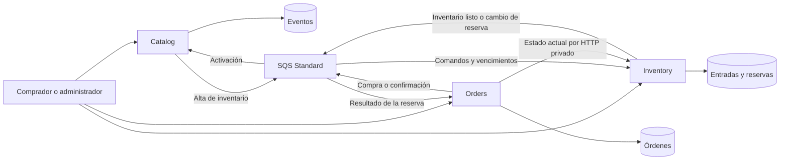
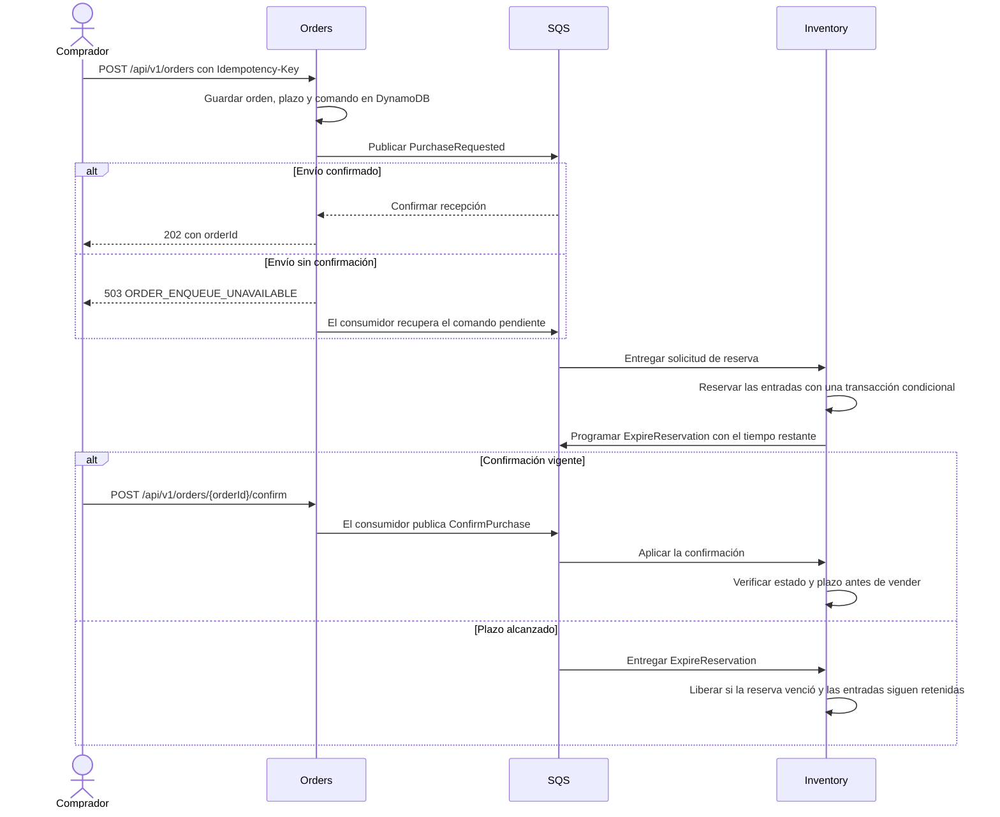

# Arquitectura

Catalog publica eventos. Orders recibe compras, confirmaciones y cortesías. Inventory asigna las entradas y calcula la disponibilidad. Cada servicio tiene su propia tabla DynamoDB y ejecuta una API WebFlux y un consumidor independiente. Los casos de uso del Scaffold Clean Architecture se conectan a HTTP, DynamoDB y SQS mediante adaptadores.

## Servicios y comunicación

SQS tiene cuatro colas principales, `inventory-commands`, `inventory-expirations`, `catalog-events` y `order-events`. Cada una tiene una cola para mensajes fallidos (DLQ). Solo Inventory cambia las entradas. Orders guarda una proyección y consulta a Inventory para obtener el estado actual.

## Compra y vencimiento

**Persistencia y concurrencia.** Orders guarda la orden y el comando en una transacción. Ese outbox permite recuperar un envío tras una caída. El `202` confirma que se aceptó el envío a SQS. La asignación se consulta después con el `orderId`. Inventory reserva todas las entradas solicitadas o rechaza el conjunto. Las condiciones de estado y versión impiden que dos compras se queden con la misma entrada.

**Plazo.** Con la configuración local, la orden conserva `expiresAt = requestedAt + 600 s`. Confirmar exige que la reserva siga vigente. El temporizador usa el tiempo restante y un barrido cada minuto recupera vencimientos pendientes. `RESERVED` y `PENDING_CONFIRMATION` ocupan capacidad. `SOLD` y `COMPLIMENTARY` son finales y las cortesías se contabilizan por separado.

**Reintentos y acceso.** SQS puede entregar un mensaje más de una vez. Los consumidores verifican identificadores y versiones antes de aplicar el cambio. Repetir una compra con los mismos datos y la misma clave conserva la orden y el plazo. Usar esa clave para otra selección devuelve `409`. Consultar como otro comprador devuelve `404`. Crear eventos y cortesías exige el rol de administrador.

**Seguridad.** La compra admite hasta diez entradas. En AWS, API Gateway valida JWT y limita la frecuencia de solicitudes. Las tareas privadas obtienen credenciales de sus roles IAM. El único permiso SQS de Orders API es `sqs:SendMessage` sobre `inventory-commands`.

**Límites y producción.** LocalStack recrea las colas vacías después de un reinicio. El ejercicio cubre reserva, confirmación y cortesía. Antes de operar en AWS, mediría la carga por partición y la antigüedad de los mensajes, y ensayaría las alarmas y la recuperación del inventario.

El [repositorio de infraestructura](../../ticketing-infra/README.md) explica la red, el aislamiento, los costos y la operación en AWS. El [diagrama editable](../../ticketing-infra/docs/diagramas/infraestructura-aws.drawio) se abre en [diagrams.net](https://app.diagrams.net/).
