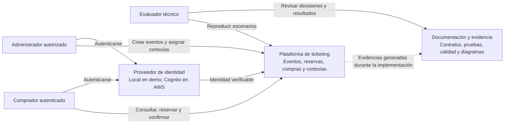
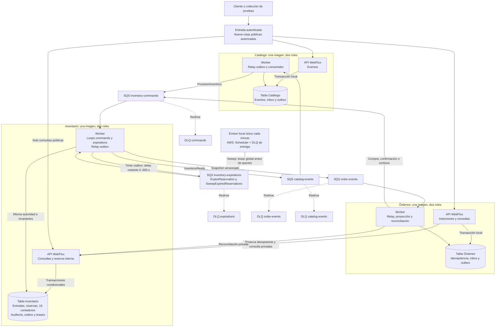
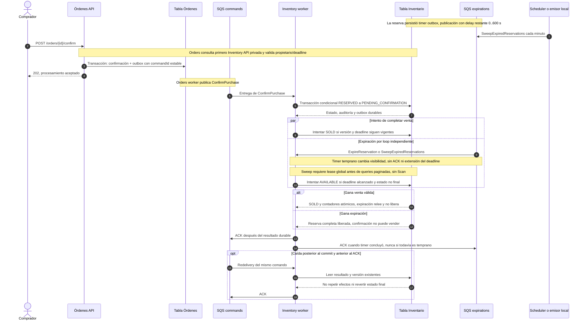
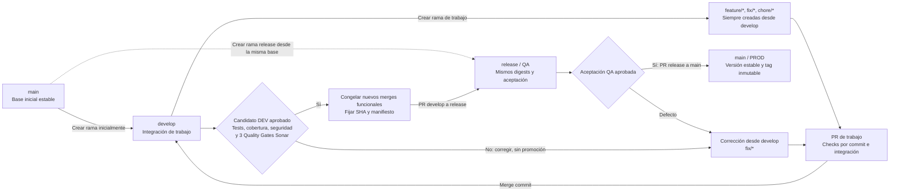
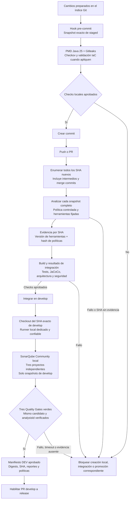
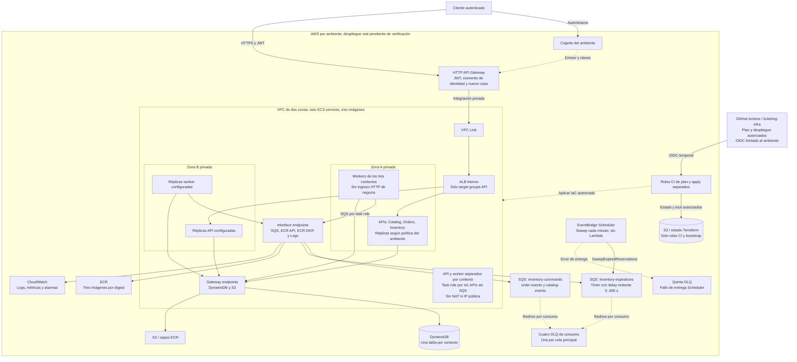

# Diagramas de la plataforma de ticketing

**Estado: diseño sincronizado con la implementación local; AWS definido en IaC, sin despliegue acreditado.**

Fecha: 16 de noviembre de 2026. Todos los diagramas describen las decisiones del plan desde cero.

Los bloques Mermaid son editables. La representación de contexto y contenedores sigue los niveles conceptuales C4, utilizando sintaxis Mermaid estándar. Los diagramas explican decisiones y componentes; no acreditan por sí solos pruebas aprobadas ni recursos AWS existentes. Los resultados se registran por separado en `ticketing-platform/docs/evidence`.

| N.º | Diagrama | Pregunta que permite responder |
|---|---|---|
| 1 | Contexto | ¿Quién utiliza la plataforma y qué queda dentro de su responsabilidad? |
| 2 | Contenedores y propietarios | ¿Dónde vive cada dato y cómo se comunican los servicios? |
| 3 | Reserva y aceptación durable | ¿Qué garantiza el `202` y cómo se recupera una reserva? |
| 4 | Confirmación contra expiración | ¿Cómo se evita vender y liberar las mismas entradas? |
| 5 | Máquina de estados | ¿Qué transiciones son válidas y cuáles son finales? |
| 6 | Ramas y promoción | ¿Cómo llega una funcionalidad desde `develop` hasta `main`? |
| 7 | Calidad por commit | ¿Cómo se valida cada SHA y dónde bloquea Sonar? |
| 8 | Despliegue AWS | ¿Cómo operan los servicios privados y aislados por ambiente? |

## 1. Contexto conceptual C4



La plataforma no incluye cobros reales, frontend de venta ni integración con sistemas internos de Nequi. El comprador se identifica mediante autenticación; no puede elegir su identidad enviando un campo en el cuerpo de la solicitud.

## 2. Contenedores, datos y mensajería



Cada microservicio posee sus datos y permisos. No hay escrituras ni transacciones entre tablas de propietarios distintos. Los relays y consumidores son roles del servicio correspondiente; el dibujo no exige desplegarlos como microservicios adicionales.

Todos los productores utilizan outbox. Una transacción de Inventario incluye la reserva, sus entradas, los contadores afectados, auditoría y evento. La garantía es de efectos de negocio idempotentes sobre entrega al menos una vez.

## 3. Crear una orden y reservar sin perder la intención

```mermaid
sequenceDiagram
    autonumber
    actor Customer as Comprador
    participant Orders as Órdenes
    participant ODB as Datos de Órdenes
    participant Inventory as Inventario
    participant IDB as Datos de Inventario
    participant Relay as Relay de Órdenes
    participant Queue as SQS de comandos

    Customer->>Orders: POST /orders + Idempotency-Key
    Orders->>Orders: Validar identidad y 1..10 entradas distintas
    Orders->>ODB: Transacción: orden RESERVING + deadline + idempotencia + outbox
    ODB-->>Orders: Intención durable, reservationId = orderId

    Orders-->>Customer: 202 + orderId + RESERVING + URL de consulta
    Note over Customer,Orders: 202 garantiza trabajo persistido; expiresAt = requestedAt + 600 s
    Note over Relay,Queue: La publicación puede ocurrir antes o después de la respuesta, no se espera para aceptar

    Relay->>ODB: Reclamar outbox pendiente con lease
    Relay->>Queue: Publicar PurchaseRequested con identidad estable
    Queue-->>Relay: Publicación confirmada
    Relay->>ODB: Registrar entrega del outbox
    Queue->>Inventory: Entregar comando, puede estar duplicado
    Inventory->>IDB: Reserva atómica + contadores + auditoría + outbox; verificar deadline
    IDB-->>Inventory: Misma reserva o resultado terminal, sin doble descuento
    Inventory->>Queue: ACK después de persistir el resultado
    Note over Inventory,IDB: Outbox publica snapshot a Órdenes y ExpireReservation a expirations
    Note over Inventory,IDB: DelaySeconds usa el deadline original, ceil restante entre 0 y 600 s
```

La reserva se procesa desde el comando durable publicado en SQS. Las redeliveries y la reconciliación conservan el mismo identificador y contenido canónico. El plazo se fija al aceptar la solicitud y no se reinicia al consumirla. Un rechazo también se registra para impedir que una redelivery tardía reserve una orden ya rechazada.

La respuesta `202` no afirma que SQS ya recibió el mensaje si este permanece en outbox. El relay recupera publicaciones pendientes cuando la cola vuelve a estar disponible.

## 4. Confirmación, expiración y recuperación del ACK



La confirmación y la expiración compiten mediante condiciones sobre la misma reserva y sus entradas. Una operación no puede liberar la asignación de otra reserva posterior. Cambiar a `PENDING_CONFIRMATION` no amplía los diez minutos.

El reloj se inyecta y cada intento comprueba el plazo. SQS no garantiza puntualidad al segundo; el timer usa el deadline original y el Sweep periódico recupera trabajo con lease/cooldown global antes de queries. Ningún retraso autoriza confirmar después de 600 s. Un timer antiguo no libera otra reserva, SOLD ni COMPLIMENTARY.

## 5. Estados oficiales de una entrada

```mermaid
stateDiagram-v2
    [*] --> AVAILABLE
    AVAILABLE --> RESERVED: Reserva condicional de todas las entradas
    RESERVED --> PENDING_CONFIRMATION: Confirmación explícita y vigente
    PENDING_CONFIRMATION --> SOLD: Consumidor confirma dentro del plazo
    RESERVED --> AVAILABLE: Reserva vencida; liberación completa
    PENDING_CONFIRMATION --> AVAILABLE: Plazo vencido antes de vender
    AVAILABLE --> COMPLIMENTARY: Cortesía administrativa autorizada
    SOLD --> [*]
    COMPLIMENTARY --> [*]
```



- `SOLD` y `COMPLIMENTARY` son finales; las flechas al marcador final no significan borrado del registro.
- `RESERVED` y `PENDING_CONFIRMATION` no son ventas.
- `COMPLIMENTARY` ocupa capacidad sin incrementar ventas.
- `RESERVING`, `REJECTED` y `EXPIRED` pertenecen al seguimiento de la orden, no agregan estados al enum de entradas.

Invariante a comprobar tras las operaciones:

```text
capacity = available + reserved + pendingConfirmation + sold + complimentary
```

## 6. Ramas, congelación y promoción del candidato



Durante la estabilización se permite trabajar en nuevas ramas, pero no integrar funcionalidades nuevas a `develop`. Las correcciones siguen el mismo flujo; no se editan `release` o `main` directamente.

Los commits de merge tendrán SHA distintos. Se compara el contenido y el manifiesto aprobado, y se promueven los mismos digests de imagen. Si el candidato cambia, la aprobación anterior deja de habilitar la promoción. Los merges no ejecutan `terraform apply` automáticamente.

## 7. Escaneo de cada commit y Sonar en develop



El hook ayuda, pero CI es la autoridad: saltarse el hook no permite integrar código sin validar. Un push con cinco commits produce evidencia de los cinco; no basta analizar `HEAD`. La creación de ramas, el historial introducido y los commits previamente comprobados se resuelven explícitamente en el enumerador. Las ejecuciones no se cancelan dejando SHA sin comprobar.

Sonar Community no se presenta como análisis nativo de PR o multirrama. Los tres proyectos reciben exclusivamente `develop`, sin mezclar análisis de ramas de trabajo, `release` o `main`. Los análisis se serializan por proyecto y esperan el resultado concreto, no el último resultado disponible.

El gate de JaCoCo mantiene al menos 90 % de líneas y ramas unitarias por servicio, aunque Sonar esté verde. Un job no puede cambiar su política y autoaprobarse: los cambios en reglas, exclusiones y workflows se revisan frente a la política controlada. Los jobs sobre código no confiable no reciben `SONAR_TOKEN` ni credenciales AWS.

## 8. AWS privado y aislamiento por ambiente



La topología se instancia por ambiente con estado, cuenta, VPC, tablas, colas, identidad, permisos y configuración independientes. Son seis servicios ECS (API/worker por contexto) y tres imágenes. PROD prevé al menos dos tareas por rol; DEV y QA pueden comenzar con una por rol. La distribución dibujada entre zonas no afirma que cada contexto tenga réplicas en ambas con mínimos de una. El dibujo no implica que exista ya alta disponibilidad demostrada.

- Sin NAT Gateway ni IP pública en las tareas.
- Sin descargas de paquetes al arrancar; imágenes completas y verificadas.
- El endpoint S3 permite descargar capas de ECR; los task roles no acceden al bucket de estado Terraform, reservado a roles CI y bootstrap.
- El ALB acepta tráfico del VPC Link y los servicios restringen sus comunicaciones mediante security groups.
- La entrada sobrescribe headers internos de identidad con claims verificados.
- Solo se exponen las operaciones públicas de Inventario; las rutas internas no se publican.
- TLS externo; el cifrado y autenticación entre workloads se documentan como evolución productiva, sin afirmar cifrado extremo a extremo en la demo.
- El acceso a Secrets Manager u otros servicios requiere agregar su conectividad privada cuando se utilice.
- SonarQube y su PostgreSQL permanecen locales, fuera de las cuentas de ejecución del producto.

## Evidencias que acompañarán a los diagramas

| Diagrama | Evidencia requerida durante la implementación |
|---|---|
| Contexto | README, alcance y colección de solicitudes. |
| Contenedores | Módulos generados, permisos por propietario y contratos AsyncAPI. |
| Reserva | Test de timeout posterior al commit y recuperación desde outbox. |
| Confirmación y expiración | Carrera real contra persistencia y redelivery posterior al commit. |
| Estados | Tests de cada transición y de irreversibilidad. |
| Ramas | PR, tags y manifiestos que conserven los digests. |
| Calidad | Resultado por SHA, reportes JaCoCo y tres analysisId de Sonar. |
| AWS | Terraform validado y, solo si se despliega, evidencia real de red e IAM. |

Los resultados locales, estáticos y reales de AWS se etiquetarán por separado. Ningún diagrama sustituye pruebas ni acredita por sí solo que una garantía esté implementada.
