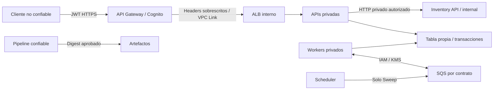

# Seguridad y modelo de amenazas

Alcance: implementación local y controles definidos en el repositorio independiente [ticketing-infra](../../ticketing-infra/docs/security.md). Esta revisión no certifica seguridad de producción, cumplimiento regulatorio ni controles AWS desplegados. Los estados de validación están en [la matriz de evidencia](evidence/requirements.md). No se atribuyen estos controles a una arquitectura interna de Nequi.

## Activos y límites de confianza

Los activos principales son titularidad/estado de entradas, capacidad y contadores, deadline de reservas, integridad de órdenes, identidad y permisos administrativos, mensajes/outbox/inbox, claves de idempotencia, evidencia de auditoría y credenciales de operación. `customerId`, actor, beneficiario y motivo de cortesía son datos que requieren acceso restringido; IDs opacos pueden seguir siendo correlacionables.

Los emuladores locales no implementan esos límites AWS: los puertos de host están en loopback, pero un proceso del usuario con acceso a Docker/red local puede llamar a APIs internas o modificar datos. Local es un entorno de desarrollo de confianza, no un despliegue multiusuario seguro.

## Identidad, ownership y administración

En AWS, API Gateway verifica JWT de Cognito y sobrescribe `X-Authenticated-Subject` y `X-Authenticated-Groups` antes de reenviar. Las aplicaciones en modo `trusted-gateway` **confían en esos headers**; no verifican otra vez la firma JWT. La seguridad depende de que el cliente no pueda llegar directamente al ALB/tarea ni conservar headers que el gateway debía reemplazar. Validar este límite en AWS es obligatorio antes de producción.

La infraestructura define nueve rutas públicas explícitas. `/internal/reservations/**` no está publicado en API Gateway. Inventory internal se autoriza por conectividad privada/security groups desde Orders API/worker, no por JWT de cliente ni mTLS de aplicación. Un workload autorizado comprometido conserva capacidad de llamar esos endpoints; existe riesgo residual de movimiento lateral dentro de ese permiso.

Orders deriva el propietario de la identidad autenticada; no acepta que un comprador elija libremente el propietario de una compra normal. La consulta/confirmación de una orden ajena devuelve 404, evitando distinguir existencia. El grupo administrativo debe ser exactamente `admin`; crear eventos y registrar cortesías requieren ese permiso. Ser administrador no concede automáticamente lectura de todas las órdenes. Las cortesías conservan actor, beneficiario y motivo para auditoría, sin contarlas como ventas.

El modo local acepta únicamente tres bearer sintéticos (`local-customer-1`, `local-customer-2`, `local-admin`) con perfil `local` y `AUTH_MODE=local`. No son secretos de producción ni tokens JWT. No activar perfil local en AWS ni exponer Compose a otras interfaces. Catalog/Orders rechazan una configuración local incompatible; Inventory no acepta las credenciales locales fuera de esa combinación. Los tests de identidad cubren los caminos locales y de headers, pero no prueban un JWT Cognito real.

## Amenazas, controles y riesgo residual

| Amenaza | Controles implementados | Evidencia / límite |
|---|---|---|
| Suplantación por headers enviados por el cliente | Gateway JWT + overwrite, ALB/tareas privados, rutas explícitas y SG. | Definición [IaC](../../ticketing-infra/docs/application-contract.md); verificación real de bypass/JWT pendiente AWS. |
| IDOR: leer o confirmar orden de otra persona | Ownership derivado de identidad; 404 para otro propietario. | [Orders HTTP tests](../services/orders/infrastructure/entry-points/reactive-web/src/test/java/com/ticketing/orders/api/RouterRestTest.java) y aceptación local. |
| Privilegio administrativo por nombre similar o payload | Grupo `admin` exacto; autorización de create event/courtesy; actor autenticado separado del beneficiario. | [Identity tests](../services/orders/infrastructure/entry-points/reactive-web/src/test/java/com/ticketing/orders/api/config/IdentityAndProblemTest.java), [Catalog identity](../services/catalog/infrastructure/entry-points/reactive-web/src/test/java/com/ticketing/catalog/api/config/IdentityFilterTest.java). |
| Doble reserva, carrera confirmar/expirar o modificación parcial | Transacciones locales, condiciones de versión/estado/propietario, counters y auditoría atómicos. | [DynamoDB Local real](../services/inventory/infrastructure/driven-adapters/dynamo-db/src/test/java/com/ticketing/inventory/dynamodb/DynamoInventoryIntegrationTest.java). No claim de todas las intercalaciones AWS. |
| Reintentar para extender plazo o vender una reserva vencida | requestedAt/expiresAt originales, comprobación de reloj en transiciones/retries, no resucitar finales. | [Use case](../services/inventory/domain/usecase/src/test/java/com/ticketing/inventory/usecase/InventoryUseCaseTest.java), timer duplicado/antiguo y confirmación final en integración. |
| Reutilizar Idempotency-Key con otra intención | Clave scoped por identidad/operación; fingerprint del contenido; rechazo de conflicto; persistencia atómica. | [Orders integration](../services/orders/infrastructure/driven-adapters/dynamo-db/src/test/java/com/ticketing/orders/dynamodb/OrdersDynamoIntegrationTest.java). TTL de auxiliares no promete deduplicación infinita. |
| Mensaje duplicado, desordenado o replay de DLQ | IDs estables, schemaVersion, versiones monotónicas, owner/deadline, transacciones e inbox donde aplica. | [SQS tests](../services/inventory/infrastructure/entry-points/sqs-listener/src/test/java/com/ticketing/inventory/sqs/listener/SQSProcessorTest.java). At-least-once, no exactly-once. |
| Worker muerto / dos líderes / ACK ajeno | Coordinador durable y lease por mensaje, condiciones owner, expiración y takeover; recovery acotado. | [DynamoDB integration](../services/inventory/infrastructure/driven-adapters/dynamo-db/src/test/java/com/ticketing/inventory/dynamodb/DynamoInventoryIntegrationTest.java). La caché de lease es optimización, no autoridad. |
| Abuso de cuerpos, selección o paginación | Límite de body 16 KiB, validación de campos, 1–10 tickets distintos, IDs y cursores acotados, paginación. | [Contratos](contracts.md) y pruebas WebFlux. No hay rate limiter distribuido local ni detección antifraude. |
| Agotamiento por mensajes inválidos o backlog | Concurrencia acotada, long polling, visibility/heartbeat, retry y DLQ; timers separados de comandos. | Consumers y [AsyncAPI](../contracts/asyncapi.json). No hay garantía de servicio ante ataque sostenido sin cuotas/rate limits cloud. |
| Compromiso de un contexto accede a datos ajenos | Tabla propia y roles separados por contexto/rol; APIs sin permisos SQS; no Scan en políticas de negocio. | [IaC verification](../../ticketing-infra/docs/verification.md). IAM efectivo y pruebas negativas pendientes AWS. |
| Robo de secretos desde Git, logs o imágenes | SDK DefaultCredentialsProvider/task roles; `.env` ignorado; escaneo Gitleaks; imágenes no requieren secretos de build. | Escaneo final por SHA pendiente; valores `localemulator` son exclusivos de emuladores. No se declara auditoría exhaustiva de secretos. |
| Alterar el pipeline para aprobar el mismo cambio | Política confiable, comprobación por commit, gate ligado a análisis/SHA, promoción por digest. | [Workflow](../.github/workflows/quality.yml), [tests](../scripts/quality/tests/test_quality.py). Requiere protección remota, revisores y runners correctamente aislados. |
| Rollback que reabre una venta o borra auditoría | Estados finales irreversibles; rollback de imagen compatible, no restauración destructiva de tablas activas. | [Runbook](runbook.md); recuperación de backup y rollback cloud no ensayados. |

## Red, cifrado y aislamiento

La infraestructura prepara tareas sin IP pública en subredes privadas de dos zonas, sin NAT, VPC endpoints, cifrado KMS y roles mínimos. API/worker comparten la tabla del mismo contexto, no tablas ajenas. Workers no están registrados en ALB y su filtro HTTP permite solo health y Prometheus. En local, aplicaciones ejecutan filesystem de solo lectura, capacidades eliminadas y `no-new-privileges`; [Compose](../compose.yaml) conserva excepciones de emuladores, incluyendo DynamoDB Local con usuario root para su volumen. No presentar el endurecimiento de las aplicaciones como aplicado a todo contenedor sin excepción.

HTTPS termina en la entrada pública AWS. Los saltos privados ALB→API y Orders→Inventory son HTTP en esta entrega; **no hay TLS de extremo a extremo ni mTLS**. La red privada reduce exposición pero no cifra esos saltos. Local usa HTTP y datos sintéticos. Antes de producción con datos sensibles se debe evaluar TLS interno/mTLS o una capa equivalente, identidad de workload y rotación de certificados.

Los endpoints Actuator expuestos son health y Prometheus; no se exponen env/configprops/heapdump. Las rutas de negocio de workers están deshabilitadas. Métricas también son información operativa sensible: AWS debe limitar su acceso y local mantiene puertos en loopback. CORS restrictivo y headers HTTP complementan el control, pero no reemplazan autenticación ni protegen llamadas de procesos no navegador.

## Datos, logs y trazas

La política es registrar IDs opacos de operación/mensaje, resultado, error class, versión y métricas, sin bearer tokens, cabeceras de autorización, payload completo, customerId, actor ni motivo. Auditar identidad/motivo en persistencia privada no implica publicarlos en stdout. Los logs de temporizador incorporan `operation`, `reservationId`, `message_id` y `outcome`; pueden correlacionarse y requieren retención/acceso limitados.

No habilitar logging HTTP/SDK de cuerpos ni imprimir objetos completos al fallar deserialización. La verificación de patrones concretos no demuestra ausencia absoluta de PII en toda biblioteca o excepción. Una auditoría de muestras reales, errores y política de redacción sigue siendo necesaria antes de producción. OTLP de logs está deshabilitado; trazas solo se exportan al activar la opción y no deben incluir tokens/cuerpos ni PII en atributos personalizados. Sampling 1.0 del perfil local es para diagnóstico, no recomendación universal de producción.

Compose rota logs locales (10 MiB, tres archivos para aplicaciones). Prometheus/Tempo locales limitan retención a 24 horas según configuración. AWS define retenciones/alarma en IaC; su efectividad se comprueba tras desplegar. TTL de DynamoDB es limpieza de auxiliares, no eliminación exacta al segundo, cumplimiento de una solicitud legal de borrado ni mecanismo de expiración de negocio. Retención de auditoría y derechos de datos personales requieren política de producción adicional.

## Cadena de suministro y comprobaciones

Las dependencias y herramientas usan versiones fijadas; imágenes locales por digest y wrapper con checksum. El proyecto parte del scaffold oficial Bancolombia y adapta sus ejemplos. Esto da procedencia, no garantiza ausencia de vulnerabilidades. Checkov incluye excepciones documentadas en [seguridad IaC](../../ticketing-infra/docs/security.md); no se deben ocultar checks omitidos ni llamar a un plan simulado “prueba cloud”.

El [hook de commit](../.githooks/pre-commit) ejecuta escaneo del contenido staged; el [workflow](../.github/workflows/quality.yml) comprueba commits y política. Un hook local puede omitirse: los controles remotos, política protegida, separación de credenciales y revisión siguen siendo necesarios. Sonar local debe analizar el SHA concreto de develop y conservar task/análisis/gate. No mezclar tokens administrativos con el job de análisis ni credenciales AWS con el runner Sonar.

Al corte de esta documentación, los tests locales citados apoyan controles de identidad, concurrencia e idempotencia. **No se declara aprobado** el SAST final de aplicación, el gate Sonar del candidato final, un pentest, el análisis completo de vulnerabilidades de dependencias/imágenes ni ninguna prueba AWS. Consultar y actualizar [evidencia](evidence/requirements.md) cuando existan reportes verificables, sin convertir pendientes en aprobados por disponer de herramientas.

## Respuesta a incidente y pendientes de producción

Ante sospecha de integridad, restringir nuevas escrituras, preservar datos y envelopes, correlacionar con IDs opacos y aplicar el [runbook de recuperación](runbook.md). Rotar/revocar la credencial afectada desde su proveedor, no publicarla como evidencia. Replay controlado conserva deadlines e IDs; no borrar idempotencia o revivir SOLD. Un restore debe diseñarse con reconciliación y protección de ventas posteriores, no copiando un snapshot antiguo sobre producción.

Pendientes de producción: validación real de JWT/header overwrite y aislamiento interno, IAM/KMS negativo, límites de abuso por cliente, cifrado de saltos privados, política de datos/retención, revisión de logs y atributos de trazas, prueba de backup/restore y rollback, análisis de dependencias/imágenes, controles remotos de Git y carga sostenida. Son límites concretos de esta entrega, no afirmaciones de incumplimiento regulatorio ni garantías de que la lista sea exhaustiva.
